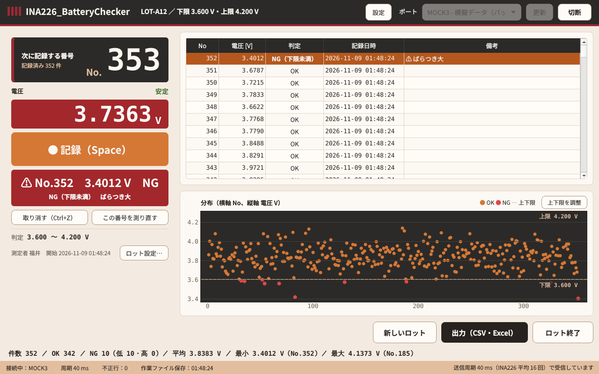

# INA226_BatteryChecker

バッテリ約 1000 個の **平常時（無負荷）の電圧** を 1 個ずつ測って記録し、CSV と Excel（.xlsx）の一覧に残す Windows 用アプリです。
ハードウェアと Arduino スケッチは [INA226_Monitor](https://github.com/FukuiJun/INA_Monitor) v1.2.1 と同じものをそのまま使います。

- 仕様書：[docs/SPEC.md](docs/SPEC.md)（v0.1 ドラフト）
- 記録値：記録ボタンを押した**後に**届いた 5 個の bus_V の中央値（40 ms 周期で約 0.2 秒）
- 判定：下限 ≦ 値 ≦ 上限 → OK、値 < 下限 → NG_LOW、値 > 上限 → NG_HIGH（境界ちょうどは OK）
- 記録のたびに作業ファイルへ自動保存。異常終了・電源断のあとも続きから再開できます



## 使い方

1. Arduino と INA226 を USB で PC に繋ぎ、`INA226_BatteryChecker.exe` を起動します
2. ヘッダー右のポートを選び「接続」（ステータス欄に「周期 40 ms」と出れば準備完了）
3. 「新しいロット」→ ロット名・測定者の社員番号・下限・上限・開始番号を入れて「開始」（前回の値が入っています）。
   測定者は名前ではなく**社員番号**（半角の英数字とハイフン、20 文字まで）を入れます。全角で打った数字は半角に直します
4. 左上の大きな番号（次に記録する番号）を確かめ、バッテリを INA226 の測定端子に繋ぐ → 電圧の横が「安定」になったら **Space**（または Enter、「● 記録」ボタン）
5. `No.12　3.8125 V　OK` のように結果が大きく出ます（OK は緑、NG は赤。⚠ はばらつき大）。バッテリを外して次へ
   NG のときは「NG です：No.12　3.4012 V（下限未満。下限 3.600 V）」という注意ウィンドウが出ます。
   「記録する」（Enter）で NG として記録、「もう一度測定」（Esc）で記録せずにその場で測り直します（また NG なら再び聞きます）
6. 間違えたら「取り消す」（**Ctrl+Z**。最後の 1 件を取り消す）、または一覧で番号を選んで「この番号を測り直す」→ そのバッテリを繋いで記録（やめるときは Esc）
7. 全部終わったら「出力（CSV・Excel）」→ 保存先フォルダとファイル名を確かめて「保存」→ CSV と xlsx ができます。続けて「ロットを終了しますか？」に答えます。
   ファイル名の初期値は `<ロット名>_<番号始め>-<番号終わり>_電圧記録_<日付>`（例：`LOT-A12_1-352_電圧記録_20261109`）で、変えることもできます

### 画面の表示

| 表示 | 意味 |
|---|---|
| バッテリ未接続 | 電圧が接続判定電圧（既定 0.5 V）未満。記録ボタンは押せません |
| 変動中 | 直近 0.5 秒の最大−最小が安定幅（既定 5 mV）を超えている。記録はできます |
| 安定 | 直近 0.5 秒の最大−最小が安定幅以内 |
| ⚠ ばらつき大 | 記録した 5 個の最大−最小が安定幅を超えた（記録はされ、備考に残ります） |

- バッテリを外さずにもう一度記録しようとすると「前回と同じバッテリのようです。もう一度記録しますか？」と確認します

### 連続測定モード

記録ボタンの上の「連続測定モード」を押してオンにすると、キーを押さずに次々と記録できます（接続中・ロットがあるときだけ）。

1. バッテリを繋ぐ → 電圧が「安定」（直近 0.5 秒の幅が安定幅以内）になったら**自動で記録**します
2. 結果が出たらバッテリを外す → 0 V（接続判定電圧 0.5 V 未満）になると、次のバッテリを記録できる状態に戻ります
3. 次のバッテリを繋ぐ → 1. に戻る

- 外さないかぎり同じバッテリを 2 回記録することはありません
- NG のときは、手動のときと同じく注意ウィンドウで「記録する／もう一度測定」を選びます（選ぶまで次へ進みません）
- 連続測定モード中も Space で手動記録・取り消し・測り直しができます。取り消した後は、繋いだままのバッテリを安定したら記録し直します
- 切断・ロット終了でオフになります。起動したときは毎回オフです
- 「設定」で、接続判定電圧・安定幅・二重記録の確認・NG の確認・記録時の音（OK と NG で違う Windows の標準音）を変えられます
- 「ロット設定…」で、ロット名・測定者の社員番号・上下限・メモを変えられます。上下限を変えると記録済みの判定もやり直します
- **上下限はグラフでも変えられます**：分布グラフ右上の「上下限を調整」を押すと、上限・下限の線をマウスでドラッグできます（0.001 V 刻み。下限は上限より上に行けません）。
  動かしている間は、その上下限で判定したときの OK／NG の色で点が変わり、ステータス欄に「… にすると NG 21 件（いま 9 件）」と出ます。
  線を離すと、判定が変わる記録があれば「判定が変わる記録が 12 件あります。変更しますか？」と確認し、「変更する」で記録の判定し直しと作業ファイルの保存をします（「やめる」なら元の位置に戻ります）。
  もう一度「上下限を調整」を押すと線が固定されます（記録中は調整できません）

### 再開

記録・取り消し・測り直しのたびに作業ファイルに保存しているので、アプリを閉じる・PC を再起動する・異常終了した場合も、
次に起動したときに「前回のロット（LOT-A12、352 件、最後は No.352）が途中です。続けますか？」と聞かれます。
「続ける」で一覧・次の番号・上下限が戻ります。作業ファイルの最終行が途中で切れていたときは、その 1 件を除いて再開します。

## 配線

INA226_Monitor と同じです。

| INA226-1A（M5Stack Unit） | Arduino UNO |
|---|---|
| 黒（GND） | GND |
| 赤（5V） | 5V |
| 黄（SDA） | A4 |
| 白（SCL） | A5 |

バッテリは **＋を INA226-1A の測定側の電圧入力（バス電圧の端子）、−を測定側の GND** に繋ぎます。
（仕様書 Q-02：実機で端子を確かめてから、ここに図を載せる予定です。）測定範囲は 0〜36 V、分解能 1.25 mV です。

## Arduino スケッチの書き込み

`firmware/ina226_logger/ina226_logger.ino` を Arduino IDE で開き、ボード（Arduino Uno / Nano）とポートを選んで書き込みます。
INA226_Monitor v1.2.1 と同じスケッチなので、書き込み済みならそのままで使えます。
起動時に `# ina226_logger fw=2` と名乗り、アプリが送る `INTERVAL 40` で送信周期を 40 ms にします。
古いスケッチ（周期変更に未対応）でも、50 ms 周期のまま記録できます（5 回で約 0.25 秒）。

## ファイル

| ファイル | 場所 |
|---|---|
| 出力 | `<保存先>\<ロット名>_<番号始め>-<番号終わり>_電圧記録_<出力した日 YYYYMMDD>.csv` / `.xlsx`（初期値。出力の画面で変えられます） |
| 作業ファイル | `%LOCALAPPDATA%\INA226_BatteryChecker\lots\<ロットID>.csv` / `.json`（終了したロットは 30 日後に削除） |
| 設定（前回値） | `%APPDATA%\INA226_BatteryChecker\settings.json` |
| ログ（エラー・警告） | `%APPDATA%\INA226_BatteryChecker\app.log`（最大 1 MB × 3 世代） |

- CSV：UTF-8（BOM 付き）・CRLF。列は `no,voltage_V,judge,min_V,max_V,measured_at,remeasured,note`（番号順）
- xlsx：「記録」（NG の判定セルは赤、1 行目固定、オートフィルタ）、「集計」（件数・OK/NG 数・OK 率・平均・中央値・最小・最大・標準偏差、
  10 mV 刻みの度数分布表と棒グラフ）、「条件」（ソフトの版・スケッチの版・送信周期・記録方法・COM ポート・メモ）の 3 シート
- 管理者権限は不要です（レジストリ・Program Files には書きません）

## 開発

Python 3.11 以上。

```bash
python -m pip install -r requirements-dev.txt
```

```bash
python run_checker.py --mock
```

`--mock` を付けると、ポート一覧に実機なしで試せる模擬シリアルが出ます（`--mock-speed 4` で 4 倍速）。

| ポート | 内容 |
|---|---|
| MOCK1 | バッテリの付け外し（1 秒外す → 2.5 秒繋ぐ、を繰り返す。電圧は個体ごとに違い、一部は 3.600〜4.200 V から外れる） |
| MOCK2 | MOCK1 ＋ 4 個に 1 個ノイズの大きいバッテリ（ばらつき大の確認） |
| MOCK3 | 1 個のバッテリを繋いだまま |
| MOCK4 | 20 秒後に USB 抜け |
| MOCK5 | 周期を変えられない古いスケッチ（50 ms のまま） |
| MOCK6 | ポートを開いてもリセットされないボード |

テスト（GUI は画面なしの offscreen で動きます）：

```bash
python -m pytest -q
```

### exe のビルド

Windows で `build.bat` を実行すると、テスト → PyInstaller → zip まで行い、
`dist\INA226_BatteryChecker\INA226_BatteryChecker.exe` と `INA226_BatteryChecker_v<版>.zip` ができます（フォルダ配布）。
GitHub に push すると Actions（`build-windows`）が同じことを行い、exe 一式をアーティファクトに残します。
Release（zip の配布）は次のどちらかで作ります。すでに同じ版の Release があれば zip を差し替えます。
- GitHub の Actions → build-windows →「Run workflow」で **release** にチェックを入れて実行（タグ `v<版>` を自動で作ります）
- `v0.1.0` のようなタグを push（タグと `battery_checker/__init__.py` の `__version__` が一致している必要があります）

### アプリアイコン

INA226 本体（INA226_Monitor のアイコンと同じ形）と電池を並べた、このアプリ専用のアイコンです（仕様 Q-10 の差し替え）。
元の絵は `assets/app_icon.svg`（背景は透過）。変えたときは次を実行すると、PNG（256・512 px）と ICO（16〜256 px の 10 サイズ）を作り直します。

```bash
python tools/build_icons.py
```

### 構成

| モジュール | 役割 | 出どころ |
|---|---|---|
| `battery_checker/protocol.py` | 受信行の判定・周期変更コマンド・応答と名乗りの解析 | INA226_Monitor そのまま（`STARTUP_DISCARD_S` を zero_cal から移した） |
| `battery_checker/serial_io.py` | ポート一覧・ポートを開く・受信スレッド | INA226_Monitor そのまま（模擬ポートを差し替え） |
| `battery_checker/mock_serial.py` | 模擬シリアル | INA226_Monitor を拡張（バッテリの付け外し） |
| `battery_checker/records.py` | 中央値・判定・連番・取り消し・測り直し・集計・度数分布 | 新規 |
| `battery_checker/measure.py` | 接続判定・安定判定・押した後の 5 回測定 | 新規 |
| `battery_checker/csvformat.py`, `workfile.py` | CSV 形式、作業ファイルの保存と再開 | 新規（INA226_Monitor の storage・recovery の考え方） |
| `battery_checker/export.py` | CSV・xlsx の出力 | 新規 |
| `battery_checker/colors.py`, `theme.py`, `style/` | 配色・フォント・スタイル | INA226_Monitor に色を追加 |
| `battery_checker/gui/` | 画面 | 新規（ヘッダー・数値バッジ・グラフの見た目は INA226_Monitor と同じ） |
| `paths.py`, `settings.py`, `logsetup.py`, `resources.py`, `filename.py` | 置き場所・前回値・ログ・同梱ファイル・ファイル名 | INA226_Monitor から名前・項目を変えて流用 |

GUI 以外のモジュールは Qt なしで動き、テストできます。

### 追加したライブラリ

- **openpyxl**：Excel（.xlsx）の作成（3 シート・色・ウィンドウ枠の固定・棒グラフ）。純 Python・MIT ライセンス（仕様 4 章）

## 仕様書から実装で決めたこと

仕様書（v0.1 ドラフト）に書かれていない点・読み方が分かれる点は、次のようにしました。変える場合は教えてください。

| 項目 | 実装 |
|---|---|
| 出力ファイル名（F-09） | 初期値は `<ロット名>_<番号始め>-<番号終わり>_電圧記録_<日付>`。日付は**出力した日**、番号は記録の最初と最後の番号です。出力の画面で名前を変えられます（使えない文字・空白は `_` にします） |
| 同じロットをもう一度出力（F-09・AC-13） | 同じフォルダに**同じ名前**で出力し直すときは、このロットの前回の出力を上書きします（同じ日・同じ番号の範囲で、測り直しなどをした後）。記録が増えて番号の範囲が変わると別の名前になり、前のファイルは残ります。ほかのファイルと名前が重なるときは上書きせず `_2` を付けます。出力の画面に、実際に保存する名前と上書きになるかを出します。「Excel で開いたまま出力するとエラー」（AC-13）は上書きのときに起きます。CSV・xlsx は一時ファイルに書いてから置き換えるので、失敗しても前回の出力は壊れません |
| 取り消しの後の二重記録の確認 | 取り消した直後は、同じバッテリをもう一度記録しても確認を出しません（取り消した理由が「測り直したい」ため） |
| 測り直しの二重記録の確認 | 測り直しでは確認を出しません（番号を選んで測り直す、と明示しているため） |
| 「新しいロット」を途中のロットがあるときに押した | 「終了して新しいロット」「途中のまま残す」「キャンセル」を選べます。残したロットは次回起動時に続けられます |
| 起動時の再開の確認 | 終了していないロットのうち最も新しい 1 つについて聞きます。「新しいロット」を選ぶと、前のロットは途中のまま残ります |
| アプリを閉じる | 確認せずに閉じます（記録はそのつど保存済み。次回起動時に続けられる） |
| NG の注意ウィンドウ | 手動・連続測定・測り直しのどれでも出します。既定のボタン（Enter）は「記録する」、Esc は「もう一度測定」。「設定」で出さないようにもできます |
| 連続測定モードの「0 V」 | 接続判定電圧（既定 0.5 V。「設定」で変更）未満になったら「外した」とみなします |
| 判定の比較 | 小数 4 桁に丸めた値どうしで比べます（画面・CSV の値と判定が食い違わないように） |
| 標準偏差 | 標本標準偏差（n−1。Excel の STDEV.S と同じ） |
| Excel の判定列 | 「OK」「NG（下限未満）」「NG（上限超え）」と日本語で出します（CSV は `OK` / `NG_LOW` / `NG_HIGH`） |
| 集計シートの終了日時 | ロット終了していればその日時、まだなら最後の記録の日時 |
| 度数分布の区間 | [下端, 上端) の 10 mV 刻み。最後の区間だけ右端（上限＋50 mV）を含みます |
